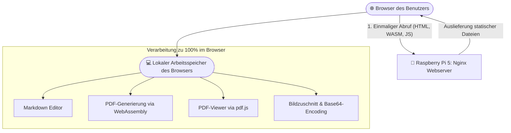
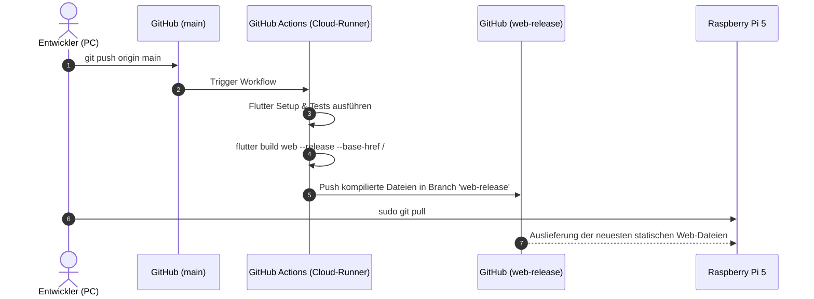

# 📄 MarkPDF – Web-Applikation: Architektur, Funktionsweise & Installation

Dieses Dokument beschreibt die technische Funktionsweise, die Architektur sowie die vollständige Installations- und Bereitstellungsanleitung für **MarkPDF** als moderne Web-Applikation auf **Laragon (lokal)** und einem **Raspberry Pi 5 (Pironman)** unter **Nginx mit HTTPS / Let's Encrypt**.

---

## 📑 Inhaltsverzeichnis
1. [Überblick & Funktionsweise](#1-überblick--funktionsweise)
   - [Architektur als Single-Page-Application (SPA)](#architektur-als-single-page-application-spa)
   - [100% Lokale Client-Verarbeitung (Datenschutz)](#100-lokale-client-verarbeitung-datenschutz)
   - [PDF-Generierung & PDF-Viewer im Browser](#pdf-generierung--pdf-viewer-im-browser)
   - [Web-kompatibles Bildhandling (Base64)](#web-kompatibles-bildhandling-base64)
   - [Progressive Web App (PWA)](#progressive-web-app-pwa)
2. [CI/CD Pipeline mit GitHub Actions](#2-cicd-pipeline-mit-github-actions)
3. [Bereitstellung auf Laragon (Windows)](#3-bereitstellung-auf-laragon-windows)
4. [Bereitstellung auf dem Raspberry Pi 5 (Pironman, Nginx)](#4-bereitstellung-auf-dem-raspberry-pi-5-pironman-nginx)
   - [Nginx-Konfiguration mit SSL](#nginx-konfiguration-mit-ssl)
   - [Installation der Web-App](#installation-der-web-app)
   - [Router-Portweiterleitung (Swisscom Internet-Box)](#router-portweiterleitung-swisscom-internet-box)
5. [Workflow für zukünftige Updates](#5-workflow-für-zukünftige-updates)
6. [Fehlerbehebung (Troubleshooting)](#6-fehlerbehebung-troubleshooting)

---

## 1. Überblick & Funktionsweise

### Architektur als Single-Page-Application (SPA)
MarkPDF wird mit dem Flutter-Web-Compiler in ein rein statisches Bundle kompiliert:
* **HTML5 (`index.html`):** Der Einstiegspunkt der Anwendung.
* **CanvasKit / WebAssembly (`canvaskit.wasm`):** Rendert Schriftarten, Vektoren und UI-Elemente pixelgenau auf einem HTML5 `<canvas>` mit nativer GPU-Beschleunigung.
* **Optimiertes JavaScript (`main.dart.js`):** Enthält die gesamte Geschäftslogik, das State-Management und die Parser.
* **Assets & Fonts:** Vektor-Icons (MaterialIcons) und Schriftarten (Google Fonts: Roboto, Merriweather, Roboto Mono).

Da es sich um eine **statische SPA** handelt, benötigt der Server (weder Laragon noch der Raspberry Pi) eine rechenintensive Backend-Laufzeitumgebung wie PHP, Node.js oder Python. Der Webserver liefert lediglich statische Dateien aus, was zu minimalem RAM-Verbrauch (~15 MB) und extrem schnellen Ladezeiten führt.



### 100% Lokale Client-Verarbeitung (Datenschutz)
* Alle eingegebenen Texte, Notizen, Tabellen und importierten Bilder verbleiben **ausschließlich im flüchtigen Arbeitsspeicher des Client-Browsers**.
* Es werden **keine Dokumente oder Formulardaten an den Server übertragen**.
* Die Konvertierung von Markdown zu PDF erfolgt direkt auf dem Rechner des Anwenders.

### PDF-Generierung & PDF-Viewer im Browser
1. **PDF-Erstellung:** Das Dart-Paket `pdf` berechnet das A4-Layout, die Schriftgrößen und Ränder clientseitig und erzeugt ein binäres `Uint8List`-Array.
2. **Drucken:** Über `printing.layoutPdf` wird direkt der Druckdialog des jeweiligen Betriebssystems (Windows, macOS, Android, iOS) aufgerufen.
3. **Anzeige:** Der integrierte Syncfusion PDF-Viewer nutzt die in `web/index.html` eingebettete Bibliothek `pdf.js` (`pdfjsLib`), um das Dokument ohne externe PDF-Reader-Plugins flüssig im Browserfenster darzustellen.

### Web-kompatibles Bildhandling (Base64)
Da Web-Apps aus Sicherheitsgründen keinen Zugriff auf das Dateisystem (`dart:io` `File('/pfad/...')`) haben:
* Importierte Bilder aus der Zwischenablage, dem Dateidialog oder der Kamera werden direkt als Bytes eingelesen.
* Nach dem Zuschneiden im Foto-Editor werden die Pixel als **Base64-Data-URL** formatiert:
  ```markdown
  
  ```
* Diese Data-URLs funktionieren plattformübergreifend: Sie werden in der Live-Vorschau sofort gerendert und von der PDF-Engine nativ in das finale Dokument eingebunden.

### Progressive Web App (PWA)
MarkPDF enthält ein `manifest.json` und einen Service-Worker (`flutter_service_worker.js`).
* **Desktop-Installation:** Im Browser (z. B. Chrome, Edge) erscheint in der Adresszeile ein **Installieren-Symbol** (oder Menü ➔ *App installieren*).
* Die App läuft dann in einem eigenen, rahmenlosen Fenster wie ein eigenständiges Desktopprogramm.

---

## 2. CI/CD Pipeline mit GitHub Actions

Das Projekt verfügt über einen vollautomatischen Cloud-Build ([.github/workflows/build_web.yml](.github/workflows/build_web.yml)):



* **Vorteil:** Auf dem Raspberry Pi muss kein Flutter-SDK installiert werden. Die ressourcenintensive Kompilierung übernimmt die GitHub-Cloud kostenlos.

---

## 3. Bereitstellung auf Laragon (Windows)

Laragon dient als lokale Entwicklungsumgebung.

1. **Build mit Deployment-Skript:**
   Im Projektverzeichnis folgendes PowerShell-Skript ausführen:
   ```powershell
   .\deploy_web.ps1 -Target Laragon -BaseHref "/"
   ```
2. **Was das Skript macht:**
   - Kompiliert das Web-Bundle mit `<base href="/">`.
   - Kopiert die Dateien nach `C:\laragon\www\pdf_writer`.
   - Generiert eine `.htaccess`-Datei für Apache SPA-Rewrites.
3. **Aufruf im Browser:**
   - Als Virtual Host: `http://pdf_writer.test:8081/` (Standard-Port in Laragon Nginx)
   - Oder über Localhost: `http://localhost:8081/`

---

## 4. Bereitstellung auf dem Raspberry Pi 5 (Pironman, Nginx)

### Nginx-Konfiguration mit SSL

Erstelle die Konfigurationsdatei auf dem Raspberry Pi:
```bash
sudo nano /etc/nginx/sites-available/pdf_writer
```

Inhalt der Konfiguration:
```nginx
server {
    listen 8048 ssl;
    listen [::]:8048 ssl;
    server_name rhz.internet-box.ch pironman.local;
    root /var/www/pdf_writer;

    # SSL-Zertifikate von Let's Encrypt
    ssl_certificate /etc/letsencrypt/live/rhz.internet-box.ch/fullchain.pem;
    ssl_certificate_key /etc/letsencrypt/live/rhz.internet-box.ch/privkey.pem;

    # Moderne SSL-Sicherheitseinstellungen
    ssl_protocols TLSv1.2 TLSv1.3;
    ssl_ciphers HIGH:!aNULL:!MD5;
    ssl_prefer_server_ciphers on;

    index index.html;
    charset utf-8;

    # Sicherheits-Header
    add_header X-Frame-Options "SAMEORIGIN";
    add_header X-Content-Type-Options "nosniff";
    add_header X-XSS-Protection "1; mode=block";

    # Gzip-Komprimierung (inklusive application/wasm für Flutter WebAssembly)
    gzip on;
    gzip_vary on;
    gzip_proxied any;
    gzip_comp_level 6;
    gzip_min_length 1024;
    gzip_types text/plain text/css application/json application/javascript text/xml application/xml image/svg+xml application/wasm;

    # SPA Routing: Leitet alle Anfragen an index.html weiter
    location / {
        try_files $uri $uri/ /index.html;
    }

    location = /favicon.ico { access_log off; log_not_found off; }
    location = /robots.txt  { access_log off; log_not_found off; }

    # Versteckte Dateien (.git etc.) sperren
    location ~ /\.(?!well-known).* {
        deny all;
    }

    # Statische Assets cachen (1 Jahr)
    location ~* \.(?:wasm|js|css|png|jpg|jpeg|gif|ico|svg|woff|woff2|ttf|otf)$ {
        expires 1y;
        add_header Cache-Control "public, max-age=31536000, immutable";
    }

    # HTML und Service-Worker nie cachen (sofortige App-Updates)
    location ~* (?:index\.html|flutter_service_worker\.js|version\.json)$ {
        add_header Cache-Control "no-cache, no-store, must-revalidate";
    }
}
```

Aktivieren und Nginx neu laden:
```bash
sudo ln -s /etc/nginx/sites-available/pdf_writer /etc/nginx/sites-enabled/
sudo nginx -t
sudo systemctl reload nginx
```

### Installation der Web-App
Klone den vorbereiteten Branch `web-release` direkt in das Webverzeichnis:

```bash
sudo rm -rf /var/www/pdf_writer
sudo git clone -b web-release https://github.com/roberthoferzuerich-alt/MarkPDF.git /var/www/pdf_writer
sudo chown -R www-data:www-data /var/www/pdf_writer
```

### Router-Portweiterleitung (Swisscom Internet-Box)
Damit die App über `https://rhz.internet-box.ch:8048/` weltweit erreichbar ist:
1. Im Webinterface der Internet-Box einloggen (`http://192.168.1.1`).
2. Unter **Netzwerk ➔ Portweiterleitung**:
   - **Bezeichnung:** `MarkPDF`
   - **Protokoll:** `TCP`
   - **Externer Port:** `8048`
   - **Internes Gerät:** Dein Raspberry Pi (z. B. `192.168.1.x`)
   - **Interner Port:** `8048`
3. Speichern.

---

## 5. Workflow für zukünftige Updates

Wenn du die App weiterentwickelst oder Textinhalte anpasst:

### Schritt A: Auf deinem PC
```bash
# Änderungen stagen, committen und pushen
git add .
git commit -m "Update: Neue Funktionen hinzugefügt"
git push origin main
```
*GitHub Actions baut die Web-App automatisch in ca. 2 Minuten neu.*

### Schritt B: Auf dem Raspberry Pi
Sobald die GitHub Action abgeschlossen ist (grüner Haken auf GitHub), führst du auf dem Pi nur diesen Befehl aus:

```bash
cd /var/www/pdf_writer && sudo git pull
```
*Die neue Version ist sofort live!*

---

## 6. Fehlerbehebung (Troubleshooting)

| Problem | Ursache | Lösung |
| :--- | :--- | :--- |
| **404 Not Found bei Unterseiten** | Nginx versucht echte Verzeichnisse statt `index.html` zu laden. | Sicherstellen, dass `try_files $uri $uri/ /index.html;` in der Nginx-Konfiguration vorhanden ist. |
| **Ältere Version wird im Browser angezeigt** | Aggressives Browser-Caching des Service-Workers. | `Strg + F5` (Hard Reload) im Browser drücken oder PWA kurz deinstallieren und neu laden. |
| **PDF-Vorschau bleibt im Web weiß** | `pdf.js` fehlt in `web/index.html`. | Sicherstellen, dass der Script-Tag für `pdf.min.mjs` vor `flutter_bootstrap.js` eingebunden ist. |
| **Permission Denied in `/var/www/pdf_writer`** | Nginx hat keine Leserechte für die Git-Dateien. | `sudo chown -R www-data:www-data /var/www/pdf_writer` ausführen. |
| **SSL-Zertifikatsfehler beim Aufruf** | Portweiterleitung oder Domain-Name passt nicht zum Let's Encrypt Zertifikat. | URL muss exakt mit dem Zertifikat übereinstimmen: `https://rhz.internet-box.ch:8048/`. |
